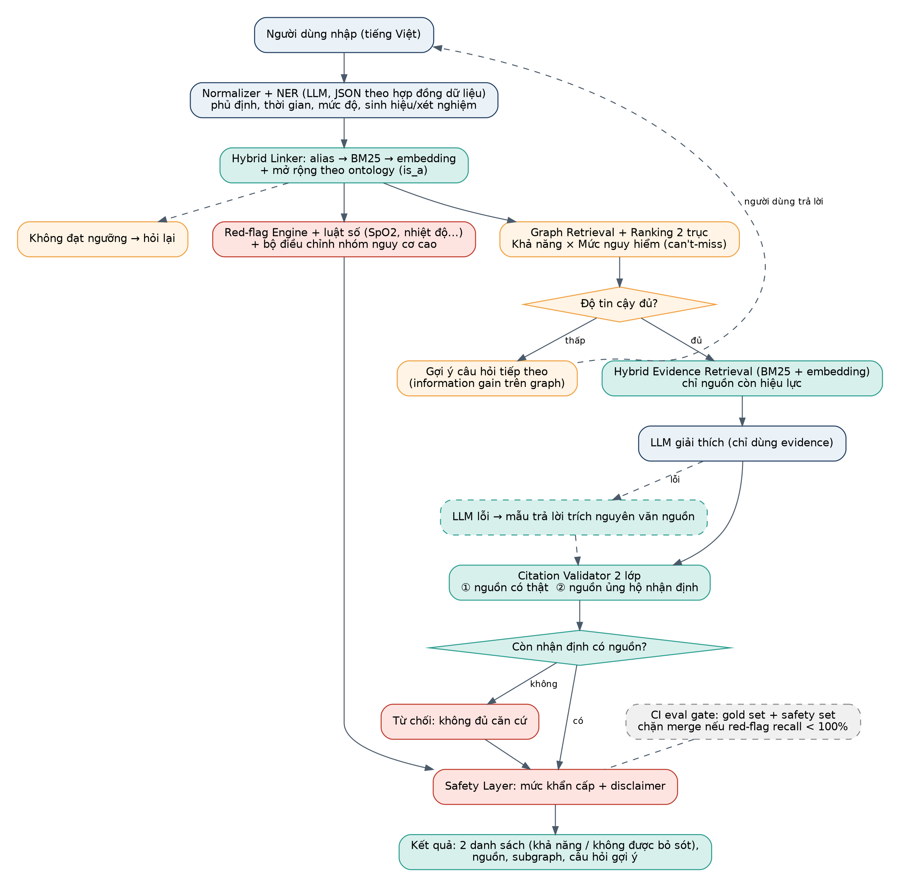

# MedGraph: Tổng quan dự án

> Hệ thống hỗ trợ phân tích triệu chứng bằng GraphRAG (Knowledge Graph + RAG + LLM), ưu tiên tiếng Việt

> **Disclaimer:** MedGraph là công cụ tham khảo và giáo dục, **không phải công cụ chẩn đoán** và không thay thế bác sĩ. Khi có dấu hiệu nguy hiểm, hãy đến cơ sở y tế hoặc gọi cấp cứu (115 tại Việt Nam).

## 1. Mô tả dự án

Người dùng nhập triệu chứng, tiền sử và kết quả xét nghiệm bằng tiếng Việt tự nhiên, ví dụ: *"ho dai dẳng 3 tuần, sốt nhẹ về chiều, tức ngực khi hít sâu"*. Hệ thống **không chỉ tìm đoạn văn có từ "ho"** mà truy vấn Knowledge Graph để tìm các bệnh có quan hệ với nhóm triệu chứng đó, sau đó dùng RAG lấy nguồn y khoa để LLM giải thích.

Chuỗi quan hệ trong graph: **Triệu chứng → Bệnh → Yếu tố nguy cơ → Xét nghiệm → Thuốc → Tác dụng phụ → Chống chỉ định** (phần thuốc, tác dụng phụ, chống chỉ định thuộc giai đoạn 2).

### Các bước xử lý

- Chuẩn hóa văn bản và trích xuất thực thể y khoa (triệu chứng, **phủ định, thời gian**, mức độ, sinh hiệu, bệnh nền, thuốc đang dùng).
- Chuẩn hóa về mã ontology (UMLS/HPO/ICD-10) bằng **Hybrid Linker** (alias, BM25, embedding) và mở rộng theo quan hệ is_a.
- Kiểm tra **red-flag**, luật số (sinh hiệu) và bộ điều chỉnh nhóm nguy cơ cao bằng luật cứng, độc lập với LLM.
- Truy vấn Knowledge Graph và **xếp hạng 2 trục**: khả năng và mức nguy hiểm (danh sách "cần loại trừ").
- Nếu độ tin cậy thấp: **không xếp hạng tự tin**, hỏi thêm câu phân biệt tốt nhất giữa các ứng viên.
- Lấy bằng chứng từ nguồn y khoa còn hiệu lực (hybrid RAG) cho từng bệnh ứng viên.
- LLM giải thích bằng tiếng Việt; **Citation Validator 2 lớp** kiểm tra nguồn có thật và nguồn ủng hộ nhận định; không còn nhận định nào có nguồn thì từ chối.
- Gắn mức khẩn cấp và disclaimer; nếu LLM lỗi vẫn trả mẫu có red-flag, bảng ứng viên và đoạn nguồn nguyên văn.

## 2. Mục tiêu và điểm khác biệt

Mục tiêu chính là **portfolio**: cho nhà tuyển dụng thấy bạn hiểu GraphRAG, biết đánh giá hệ thống và xử lý được bài toán tiếng Việt.

| Điểm khác biệt | Ý nghĩa |
|---|---|
| Chẩn đoán phân biệt có trọng số | Xếp hạng theo độ đặc hiệu triệu chứng (IDF trên graph), không chỉ đếm số triệu chứng khớp |
| Red-flag layer độc lập LLM | Cảnh báo cấp cứu bằng luật, luôn hiển thị kể cả khi LLM lỗi |
| Entity linking tiếng Việt | Hiểu cách nói đời thường: "tức ngực", "ho dai dẳng", "sốt âm ỉ" |
| Đánh giá định lượng | So sánh LLM-only, RAG thường và GraphRAG trên bộ case tự soạn |
| Giải thích trực quan | Hiển thị subgraph đường suy luận: Triệu chứng → Bệnh, kèm trọng số |
| Ranking 2 trục | Tách "khả năng cao nhất" khỏi "cần loại trừ" (bệnh hiếm nhưng nguy hiểm), điều Lawgic không có |
| Trích dẫn có kiểm chứng 2 lớp | Kiểm tra nguồn có thật và nguồn **ủng hộ** nhận định; không đủ căn cứ thì từ chối |
| Biết hỏi thêm và biết từ chối xếp hạng | Điểm top-1 và top-2 sát nhau thì hỏi câu phân biệt thay vì đoán |
| Cạnh có nguồn gốc và độ tin cậy | provenance (curated, auto_extracted, reviewed) ảnh hưởng trọng số ranking |


|  | MedGraph |  
|---|---|---|
| Bản chất suy luận | Suy luận ngược từ triệu chứng ra bệnh ứng viên, mang tính xác suất, cần xếp hạng | Truy xuất và lập luận trên điều luật, mang tính quy phạm |
| Quan hệ trong graph | Triệu chứng, Bệnh, Xét nghiệm, Thuốc, Chống chỉ định | Luật, Chương/Điều/Khoản, sửa đổi/thay thế, dẫn chiếu |
| Thách thức dữ liệu | Alias tiếng Việt, ánh xạ mã chuẩn (UMLS, ICD) | Hiệu lực theo thời gian, văn bản thay thế |
| Rủi ro | An toàn người bệnh, red-flag | Trích sai hoặc bịa điều luật |
| Đánh giá | Top-k accuracy trên case bệnh | Độ chính xác trích dẫn điều/khoản |

Trong README nên nhấn vào những gì đặc thù của y khoa: xếp hạng chẩn đoán phân biệt, red-flag, linking tiếng Việt và phần đánh giá baseline vs GraphRAG.

## 4. Phạm vi MVP

Chỉ làm **nhóm bệnh hô hấp** (khoảng 30 đến 40 bệnh): viêm phổi, lao phổi, hen, COPD, viêm phế quản, COVID-19, cúm, GERD gây ho, thuyên tắc phổi, tràn khí màng phổi... Ví dụ "ho kéo dài + sốt nhẹ + đau ngực" rơi đúng vào nhóm này nên demo rất thuyết phục. Phần thuốc, tác dụng phụ và chống chỉ định để làm "giai đoạn 2". Một vertical hẹp làm kỹ có giá trị hơn một graph rộng nhưng nông.



*Hình 1. Pipeline MedGraph v2 (xanh lá: học từ Lawgic, cam: cải tiến riêng, đỏ: an toàn)*

## 5. Nguyên tắc thiết kế

| Nguyên tắc | Cách áp dụng trong MedGraph |
|---|---|
| Hợp đồng đóng băng từ đầu | models/schemas.py (dữ liệu) và graph/schema.py (graph) viết trước khi code module; mọi module trao đổi qua hợp đồng |
| Nguồn sự thật xác định, LLM chỉ là lớp phụ | Nội dung y khoa chỉ lấy nguyên văn từ nguồn đã nạp; cạnh do LLM trích xuất gắn nhãn auto_extracted và có trọng số thấp hơn |
| Grounding không thương lượng | Không còn trích dẫn hợp lệ thì từ chối; red-flag vẫn luôn hiển thị |
| Batch khác online | Việc nặng (parse, trích xuất, embedding, nạp graph) chạy offline và idempotent; đường truy vấn chỉ truy xuất và giải thích; tab tra cứu không gọi LLM |
| Suy giảm có kiểm soát | LLM lỗi: trả red-flag, bảng ứng viên và đoạn nguồn nguyên văn |
| Mọi quyết định có một con số | Gold set, ablation, bảng yêu cầu và bằng chứng; hạn chế được nêu công khai |

## 6. Tech stack

| Thành phần | Lựa chọn | Ghi chú |
|---|---|---|
| Graph DB | Neo4j (AuraDB Free hoặc Docker) | Cypher, có Bloom/Browser để trực quan hóa |
| Vector store | Qdrant (hoặc pgvector, Chroma) | Lưu embedding của chunk tài liệu |
| Embedding | bge-m3 / multilingual-e5 | Hỗ trợ đa ngôn ngữ, phù hợp tiếng Việt |
| NER + giải thích | Claude API (structured output) | Model nhỏ cho NER, model lớn cho giải thích |
| Backend | FastAPI, Pydantic | REST API, kiểm tra schema |
| Frontend | Streamlit (MVP) | Có thể nâng cấp Next.js sau |
| Trực quan graph | pyvis / streamlit-agraph | Vẽ subgraph đường suy luận |
| Truy xuất từ vựng | BM25 (rank_bm25) hoặc hybrid của Qdrant | Kết hợp với embedding cho linker và evidence |
| Kiểm thử và CI | pytest, Neo4j service container, ruff, GitHub Actions | Eval gate: chặn merge nếu red-flag recall dưới 100% |
| Hạ tầng | Docker Compose | Neo4j + Qdrant + API chạy một lệnh |
| Deploy | Hugging Face Spaces / Render | Kèm video demo 2 phút |

## 7. Cấu trúc thư mục

```
medgraph/
├── README.md
├── docker-compose.yml            # Neo4j + Qdrant (+ API)
├── .env.example
├── requirements.txt
├── config/
│   ├── settings.yaml
│   ├── ranking.yaml              # tham số xếp hạng, ngưỡng linking, ngưỡng abstain
│   └── red_flags.yaml            # red-flag, modifiers nhóm nguy cơ cao, luật số
├── prompts/                      # prompt có version: extract, explain, judge
├── data/
│   ├── raw/                      # không commit nếu có license
│   ├── processed/                # nodes/edges đã chuẩn hóa
│   ├── aliases_vi/               # symptoms.csv, diseases.csv
│   └── eval/                     # gold_ner, gold_ranking, gold_qa, safety_set (.jsonl)
├── docs/                         # tài liệu thiết kế
├── src/medgraph/
│   ├── models/schemas.py         # HỢP ĐỒNG DỮ LIỆU (Pydantic), đóng băng sớm
│   ├── api/                      # main.py, routes.py
│   ├── nlp/                      # normalizer.py, extractor.py, linker.py
│   ├── graph/                    # schema.cypher (HỢP ĐỒNG GRAPH), loader.py,
│   │                             # retrieval.py, ranking.py, followup.py
│   ├── rag/                      # chunker.py, embedder.py, retriever.py, validator.py
│   ├── safety/                   # red_flags.py, modifiers.py, guardrails.py
│   ├── llm/                      # client.py (đổi provider bằng biến môi trường)
│   └── pipeline.py
├── scripts/                      # build_graph.py (idempotent), build_aliases.py,
│                                 # ingest_docs.py, run_eval.py
├── eval/                         # metrics.py, baselines.py, judge.py, report.py
├── app/streamlit_app.py          # 3 tab: Phân tích, Tra cứu graph, Giải thích
├── tests/                        # linker, ranking, red_flags, validator, safety
└── .github/workflows/ci.yml      # test + Neo4j container + eval gate
```

## 8. API dự kiến

| Method | Endpoint | Mô tả |
|---|---|---|
| POST | /analyze | Nhận văn bản, trả về ứng viên, giải thích, nguồn, urgency, subgraph |
| GET | /search | Tra cứu full-text triệu chứng/bệnh trên graph (không gọi LLM) |
| GET | /graph/subgraph | Lấy subgraph quanh một node để vẽ đường suy luận |
| GET | /graph/disease/{id} | Chi tiết một bệnh, quan hệ và nguồn |
| GET | /health | Kiểm tra kết nối Neo4j, Qdrant |
| POST | /feedback | Đánh giá kết quả (không lưu nội dung nhạy cảm) |

#### Ví dụ response /analyze

```json
{
  "abstained": false,
  "urgency": "SEE_DOCTOR_SOON",
  "red_flags": [],
  "entities": [{"text": "ho dai dẳng", "id": "HP:0012735", "negated": false, "duration_days": 21}],
  "likely": [
    {"disease_id": "ICD10:A15", "name_vi": "Lao phổi", "likelihood": 0.82, "danger_level": 3,
     "claims": [{"text": "...", "citation": {"chunk_id": "...", "supported": true}}]}
  ],
  "cant_miss": [{"disease_id": "ICD10:I26", "name_vi": "Thuyên tắc phổi", "likelihood": 0.12, "danger_level": 3}],
  "follow_up_questions": ["Bạn có ho ra máu không?"],
  "subgraph": {"nodes": [], "edges": []},
  "disclaimer": "..."
}
```

Các giá trị trong ví dụ chỉ để minh họa định dạng, không phải kết quả thật của hệ thống.

## 9. Chạy thử (dự kiến)

```
cp .env.example .env            # điền API key
docker compose up -d            # Neo4j + Qdrant
pip install -r requirements.txt
python scripts/build_graph.py
python scripts/ingest_docs.py
uvicorn medgraph.api.main:app --reload
streamlit run app/streamlit_app.py
```

### Checklist repo gây ấn tượng

- README có sơ đồ kiến trúc, GIF demo và mục "Hạn chế đã biết".
- Bảng kết quả đánh giá (baseline vs GraphRAG).
- Disclaimer rõ ràng: công cụ tham khảo, không thay thế bác sĩ.
- Không lưu dữ liệu người dùng thật trong bản demo.
- Có unit test và CI cho linker, ranking, red-flag, validator.
- Có safety set và eval gate trong CI.

## 10. Bảng năng lực và bằng chứng (mẫu cho README)

| # | Năng lực | Bằng chứng (điền sau khi chạy đánh giá) |
|---|---|---|
| 1 | Chuẩn hóa triệu chứng tiếng Việt về mã chuẩn | Linking recall, F1 theo loại thực thể |
| 2 | Xếp hạng bệnh ứng viên | Top-1/3/5, MRR so với B0 và B1; can't-miss recall |
| 3 | Cảnh báo cấp cứu | Red-flag recall 100%, over-alert rate |
| 4 | Giải thích có trích dẫn | Citation exists rate, citation support rate |
| 5 | Từ chối và hỏi thêm an toàn | Refusal rate trên safety set, đường cong coverage–accuracy |
| 6 | Truy vết nguồn và phiên bản | % cạnh có source_id, % nguồn còn hiệu lực |
| 7 | Giao diện và API | 3 tab, /analyze, /search, /graph/subgraph |
