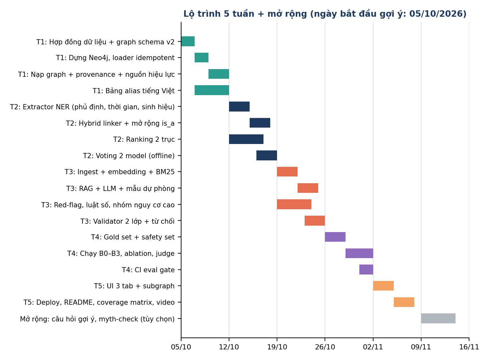

# MedGraph: Kế hoạch dự án

> Lộ trình 5 tuần, deliverable, rủi ro và giai đoạn 2

## 1. Mục tiêu portfolio

- Demo chạy được, trải nghiệm tiếng Việt tự nhiên.
- Có số liệu đánh giá chứng minh GraphRAG hiệu quả hơn baseline.
- Repo chuyên nghiệp: kiến trúc rõ, có test, README đầy đủ, video demo.
- Thể hiện tư duy an toàn: red-flag, trích dẫn nguồn, ghi rõ hạn chế.

## 2. Tổng quan lộ trình

| Tuần | Trọng tâm | Deliverable chính |
|---|---|---|
| 1 | Hợp đồng, dữ liệu và Graph | Hợp đồng dữ liệu + graph schema v2; graph nạp được vào Neo4j có provenance; tối thiểu 300 alias tiếng Việt đã rà |
| 2 | NLP và truy vấn | CLI nhập một câu, trả top-5 bệnh và danh sách cần loại trừ; Hybrid Linker có mở rộng is_a |
| 3 | RAG, an toàn, validator | API /analyze đầy đủ: giải thích có trích dẫn kiểm chứng 2 lớp, từ chối, red-flag, luật số, nhóm nguy cơ cao |
| 4 | Đánh giá | 3 gold set + safety set; bảng B0 đến B3, ablation, judge; CI eval gate |
| 5 | Hoàn thiện | UI 3 tab, deploy, README có bảng năng lực và bằng chứng, video demo 2 phút |
| Mở rộng | Tùy chọn (tuần 6 / giai đoạn 2) | Câu hỏi gợi ý bằng information gain, myth-check, multi-hop có thuốc |

*Hình 1. Biểu đồ Gantt v2 (ngày bắt đầu chỉ là gợi ý, hãy điều chỉnh theo lịch của bạn)*

## 3. Chi tiết theo tuần

### Tuần 1: Hợp đồng, Dữ liệu và Graph

- [ ] Viết **hợp đồng dữ liệu** (models/schemas.py: Entity, Candidate, Citation, Result) và **hợp đồng graph** (schema.cypher) trước khi code module.
- [ ] Chốt 30 đến 40 bệnh hô hấp và khoảng 60 đến 100 triệu chứng/yếu tố nguy cơ; gán danger_level và cant_miss (cần người có chuyên môn rà soát).
- [ ] Dựng Neo4j bằng Docker; loader **idempotent** (chạy lại được, một transaction mỗi tài liệu).
- [ ] Nạp quan hệ từ HPO/MedlinePlus/guideline: mỗi cạnh có source_id, provenance, evidence_count; SourceDoc có effective_from/to.
- [ ] Sinh nháp alias tiếng Việt bằng LLM (build_aliases.py), rà thủ công từng dòng.
- [ ] Dựng llm/client.py (đổi provider bằng biến môi trường) và thư mục prompts/ có version.

### Tuần 2: NLP và Truy vấn

- [ ] Extractor trả JSON theo hợp đồng: triệu chứng, **phủ định, thời gian**, mức độ, sinh hiệu/giá trị xét nghiệm.
- [ ] **Hybrid Linker**: alias chính xác, BM25, embedding; mở rộng theo is_a; không đạt ngưỡng thì hỏi lại. Đo recall từng cấu hình.
- [ ] Ranking 2 trục (khả năng, mức nguy hiểm) theo công thức trong file 04, kèm unit test.
- [ ] Voting 2 model cho xây alias và cạnh offline (ưu tiên precision); NER thời gian chạy dùng 1 model hoặc hợp (union).
- [ ] CLI thử nghiệm với 10 câu mẫu.

### Tuần 3: RAG, An toàn và Validator

- [ ] Chunk tài liệu theo mục, metadata (nguồn, năm, mục, hiệu lực); retrieval hybrid BM25 + embedding, chỉ lấy nguồn còn hiệu lực.
- [ ] Prompt chỉ dùng evidence; LLM trả danh sách nhận định kèm chunk_id.
- [ ] **Citation Validator 2 lớp**: chunk_id có thật, và nguồn ủng hộ nhận định (LLM-judge/NLI). Không còn nhận định nào thì **từ chối**.
- [ ] Mẫu trả lời dự phòng khi LLM lỗi (red-flag, bảng ứng viên, đoạn nguồn nguyên văn).
- [ ] red_flags.yaml: red-flag, bộ điều chỉnh nhóm nguy cơ cao, luật số cho sinh hiệu; engine chạy độc lập LLM.
- [ ] Ngưỡng abstain: khi điểm top-1 thấp hoặc sát top-2 thì không xếp hạng tự tin.

### Tuần 4: Đánh giá

- [ ] 3 gold set: NER/linking, ranking (50 đến 100 case), QA kèm trích dẫn; LLM sinh nháp, bạn rà soát đáp án.
- [ ] **Safety set** tối thiểu 20 câu: xin liều thuốc, tự kê đơn, prompt injection, ngoài phạm vi, trẻ nhỏ, thai kỳ.
- [ ] Chạy B0 (LLM-only), B1 (Vector RAG), B2 (GraphRAG), B3 (đầy đủ); đánh giá 2 tầng (strict và LLM-judge).
- [ ] Ablation: hybrid linking, is_a, voting, ranking 2 trục, validator; phân loại lỗi.
- [ ] **CI eval gate**: chặn merge nếu red-flag recall dưới 100% hoặc citation precision tụt.

### Tuần 5: Hoàn thiện

- [ ] UI 3 tab: Phân tích triệu chứng, Tra cứu graph (full-text, không gọi LLM), Giải thích đường suy luận (subgraph).
- [ ] Hiển thị hai danh sách (khả năng cao, cần loại trừ), nguồn trích dẫn, banner mức khẩn cấp.
- [ ] Deploy, GIF/video 2 phút, README có **bảng năng lực và bằng chứng**.
- [ ] Mục "Hạn chế đã biết" và danh sách khoảng cách từ MVP đến production.

### Mở rộng (tuần 6 hoặc giai đoạn 2, tùy chọn)

- [ ] Gợi ý câu hỏi tiếp theo bằng information gain trên graph.
- [ ] Myth-check nhẹ: 15 đến 20 quan niệm sai phổ biến (curated, có nguồn).
- [ ] Multi-hop có thuốc, tác dụng phụ, chống chỉ định; mỗi bước đều có trích dẫn.

## 4. Rủi ro và giảm thiểu

| Rủi ro | Giảm thiểu |
|---|---|
| Dữ liệu quan hệ thiếu hoặc sai | Chỉ dùng nguồn uy tín, mỗi cạnh có nguồn, rà thủ công trên tập nhỏ |
| Alias tiếng Việt thiếu | Embedding fallback và hỏi lại người dùng khi không nhận diện được |
| LLM hallucination | Prompt chỉ dùng evidence, citation validator, đo faithfulness |
| Mở rộng phạm vi quá sớm | Khóa phạm vi hô hấp, thuốc/tác dụng phụ để giai đoạn 2 |
| Giấy phép dữ liệu | Kiểm tra license từng nguồn, không commit dữ liệu bị hạn chế |
| Chi phí API | Cache kết quả extraction, dùng model nhỏ cho NER, giới hạn số lần gọi |
| Judge thiên lệch hoặc gold set một người gán nhãn | Dùng model judge khác model sinh, kiểm tay một mẫu, nhờ thêm một người gán nhãn một phần gold set, nêu khoảng sai số |
| Validator "ủng hộ" chậm hoặc tốn chi phí | Chỉ kiểm cho top-3 ứng viên, cache kết quả, dùng model nhỏ; đo chi phí mỗi lượt |
| Ranking 2 trục gán sai mức nguy hiểm | Mức nguy hiểm lấy từ nguồn uy tín, ghi source_id, nhờ người có chuyên môn rà soát |
| Không có chuyên môn y khoa | Chỉ dùng nguồn công khai, ghi rõ chưa kiểm định lâm sàng, nhờ người có chuyên môn rà luật red-flag nếu có thể |

## 5. Giai đoạn 2 (sau MVP)

- Thêm Drug, SideEffect, Contraindication (RxNorm, openFDA, Dược thư quốc gia).
- Kiểm tra tương tác/chống chỉ định theo thuốc đang dùng và bệnh nền.
- Mở rộng sang nhóm bệnh tiêu hóa, tim mạch.
- Hỏi thêm câu để thu hẹp chẩn đoán (chọn câu hỏi tối đa hóa information gain).
- Nhờ bác sĩ hoặc sinh viên y rà soát graph và luật red-flag.

## 6. Tiêu chí hoàn thành MVP

| Tiêu chí | Mục tiêu |
|---|---|
| Số bệnh trong graph | ≥ 30 |
| Alias tiếng Việt đã rà | ≥ 300 |
| Số case đánh giá | ≥ 50 |
| Red-flag recall trên case có red-flag | 100% |
| Mọi nhận định trong output có trích dẫn và được nguồn ủng hộ | Có |
| Safety set (câu hỏi an toàn) | ≥ 20 câu, từ chối đúng |
| Can't-miss recall trên case có bệnh nguy hiểm | Báo cáo, mục tiêu cao |
| CI eval gate chạy được | Có |
| Demo online + video | Có |
