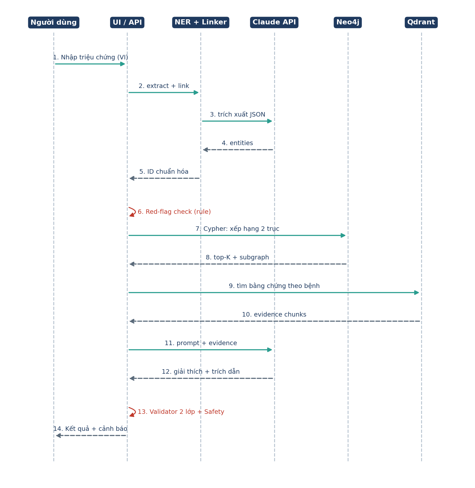
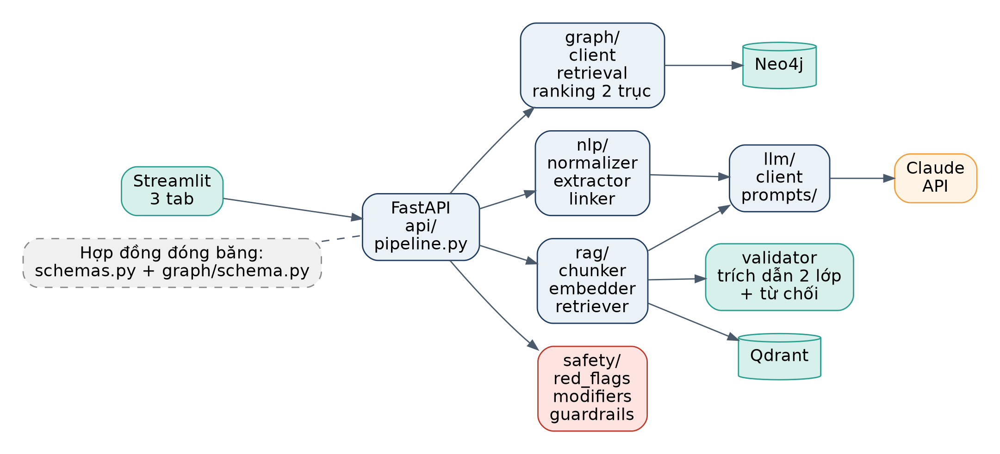
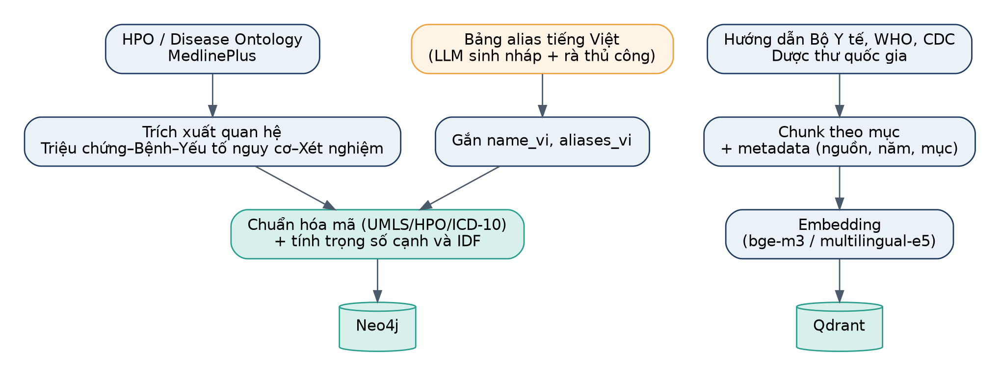
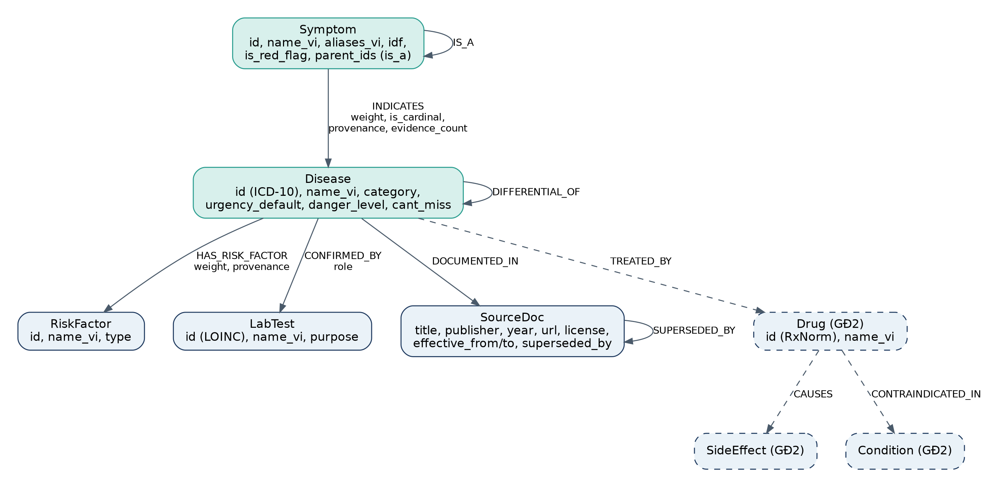
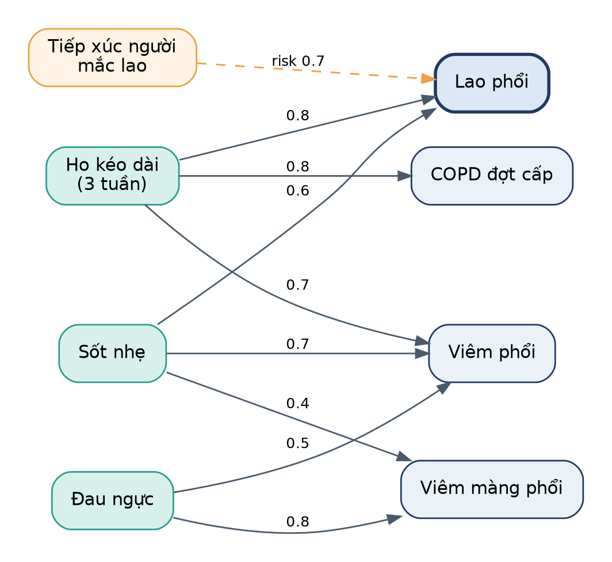
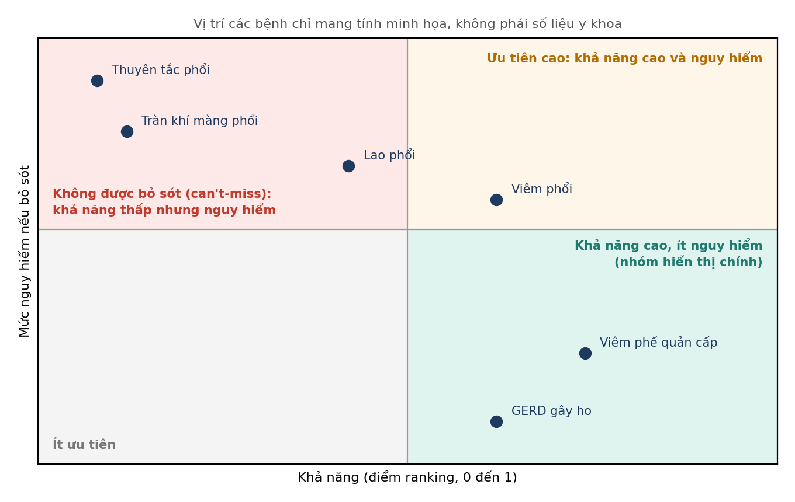
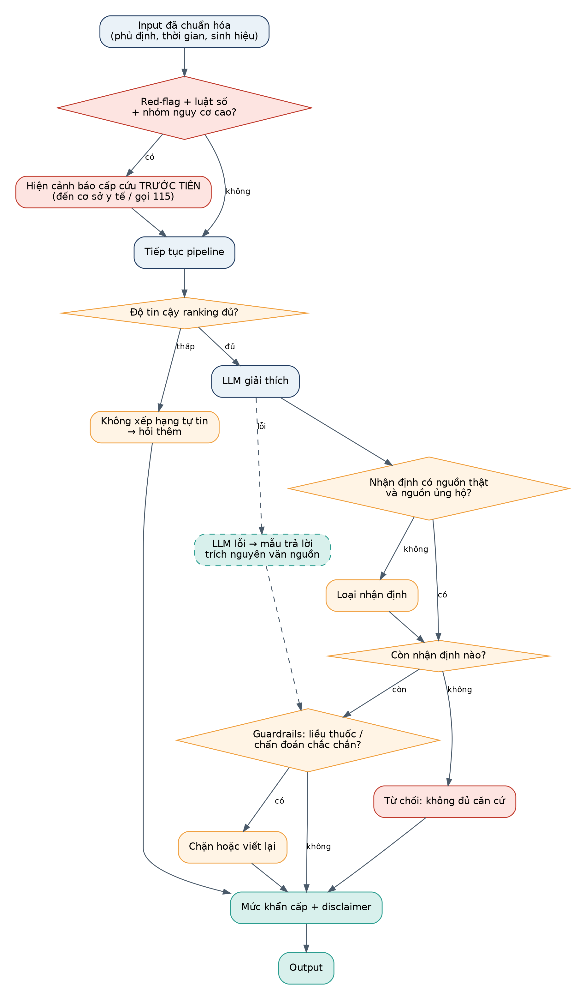
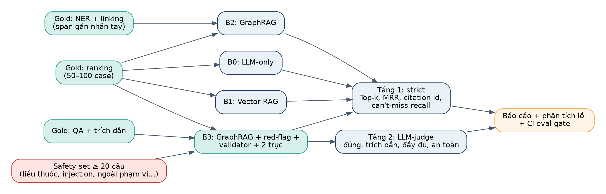

# MedGraph: Bộ sơ đồ

> Pipeline, kiến trúc, luồng dữ liệu, schema graph, an toàn và đánh giá

Tài liệu tập hợp các sơ đồ cần thiết cho dự án. Mỗi sơ đồ có phần giải thích ngắn để dùng trong README và buổi trình bày.

## 1. Pipeline xử lý

Luồng chính từ lúc người dùng nhập đến khi trả kết quả. **Red-flag Engine** chạy song song với truy vấn graph và không phụ thuộc LLM, nên cảnh báo cấp cứu luôn xuất hiện kể cả khi LLM lỗi. Khi độ tin cậy ranking thấp, hệ thống hỏi thêm thay vì đoán; sau khi LLM giải thích, Citation Validator 2 lớp lọc nhận định, và nếu không còn nhận định nào có nguồn thì từ chối.

*Hình 1. Pipeline v2 *

## 2. Sơ đồ tuần tự

Thứ tự gọi giữa các thành phần cho một lượt phân tích. Các bước 6 và 13 (màu đỏ) là xử lý nội bộ của backend. Với ranking 2 trục, truy vấn Cypher trả cả khả năng và mức nguy hiểm.

*Hình 2. Sequence diagram của endpoint /analyze*

## 3. Kiến trúc thành phần

Backend chia module theo trách nhiệm. Chỉ module llm/ gọi Claude API, giúp dễ thay mô hình và kiểm soát chi phí. Hai file hợp đồng (schemas.py, schema.cypher) được đóng băng sớm để mọi module trao đổi qua giao diện ổn định; validator nằm riêng để kiểm thử độc lập.

*Hình 3. Các thành phần và kết nối*

## 4. Luồng xây dựng dữ liệu (offline)

Chạy một lần (hoặc khi cập nhật dữ liệu) trước khi khởi động hệ thống. Bảng alias tiếng Việt cần được rà thủ công vì quyết định chất lượng entity linking.

*Hình 4. Xây dựng Knowledge Graph và vector store*

## 5. Schema Knowledge Graph

Thực thể màu xanh là phạm vi MVP, thực thể nét đứt thuộc giai đoạn 2. Mọi cạnh có **source_id** và **provenance** để truy vết nguồn gốc; Disease có **danger_level** và **cant_miss** cho ranking 2 trục; Symptom có quan hệ **IS_A** để mở rộng ontology; SourceDoc có hiệu lực theo thời gian và **SUPERSEDED_BY**.

*Hình 5. Node và quan hệ (v2)*

## 6. Ví dụ subgraph cho một truy vấn

Minh họa cho đầu vào "ho kéo dài + sốt nhẹ + đau ngực" kèm yếu tố nguy cơ "tiếp xúc người mắc lao". Số trên cạnh là **trọng số minh họa**, không phải số liệu y khoa đã kiểm định. Giao diện sẽ vẽ subgraph kiểu này để người dùng thấy vì sao hệ thống đưa ra từng ứng viên.

*Hình 6. Subgraph minh họa (trọng số giả định)*

## 7. Ranking 2 trục: khả năng và mức nguy hiểm

Mỗi bệnh được đặt trên hai trục. Kết quả trả về hai danh sách: **khả năng cao nhất** (xếp theo likelihood) và **cần loại trừ** (bệnh nguy hiểm, khả năng không quá thấp). Cách này tránh bỏ sót bệnh hiếm nhưng nghiêm trọng. Mức nguy hiểm cần được gán từ nguồn uy tín và người có chuyên môn rà soát.

*Hình 7. Ranking hai trục (vị trí các bệnh chỉ mang tính minh họa)*

## 8. Các lớp an toàn

Red-flag, luật số và bộ điều chỉnh nhóm nguy cơ cao được kiểm tra đầu tiên. Nếu độ tin cậy ranking thấp, hệ thống hỏi thêm. Sau khi LLM sinh nội dung, validator lọc nhận định (nguồn có thật và ủng hộ), từ chối khi không còn nhận định nào, rồi guardrails chặn liều thuốc hoặc chẩn đoán chắc chắn. LLM lỗi thì dùng mẫu trả lời dự phòng.

*Hình 8. Luồng an toàn v2*

## 9. Luồng đánh giá

Cùng một bộ case chạy qua bốn hệ thống để so sánh công bằng. Có 3 gold set và một safety set; đánh giá 2 tầng: strict (số liệu nghiêm ngặt) và LLM-judge (đúng, trích dẫn, đầy đủ, an toàn). CI chặn merge nếu chỉ số an toàn tụt.

*Hình 9. So sánh B0 đến B3 và đánh giá 2 tầng*

## 10. Mức khẩn cấp hiển thị

| Mức | Ý nghĩa | Hiển thị |
|---|---|---|
| EMERGENCY | Có red-flag nghiêm trọng | Banner đỏ: đến cấp cứu hoặc gọi 115 ngay |
| SEE_DOCTOR_SOON | Nên khám trong vài ngày | Banner cam |
| MONITOR | Theo dõi, khám nếu nặng lên | Banner vàng kèm dấu hiệu cần đi khám |
| SELF_CARE_INFO | Thông tin chung | Banner xanh (vẫn có disclaimer) |
